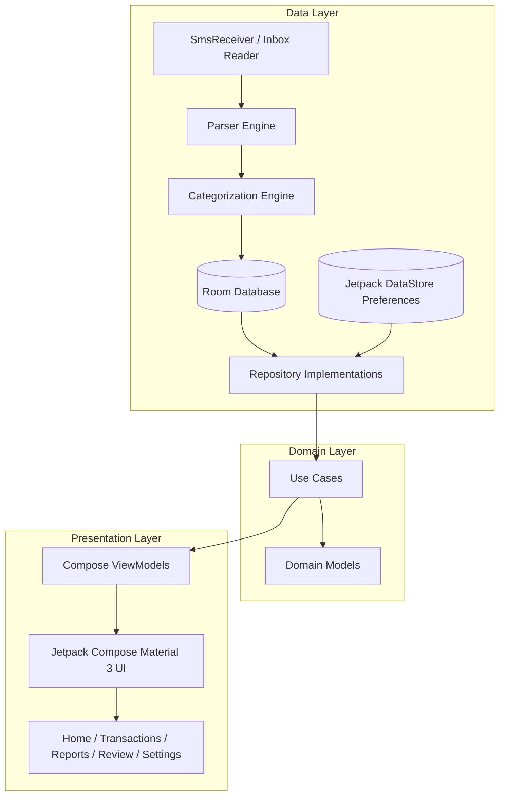

# Ethiopian Finance Tracker (የኢትዮጵያ ፋይናንስ ተከታታይ)

A native Android application built in Kotlin with Jetpack Compose that tracks personal financial activity by ingesting and structuring bank and mobile-money SMS messages (Commercial Bank of Ethiopia, Telebirr via `127`, Awash, Dashen, Bank of Abyssinia, etc.).

---

## 1. Architecture Overview

Built using **Clean Architecture** and **MVVM** with unidirectional data flow (UDF), 100% offline with zero network permissions.



---

## 2. Key Features

- **Dual Mode System**:
  - **Demo Mode**: Active by default on first launch. Populated with realistic sample data (matching exact layout figures: 10,834.84 ETB total, 8,034.84 ETB digital, 2,800.00 ETB cash, +4,000.00 income, -676.26 expenses, 3,323.74 net flow). Requires zero permissions.
  - **Live Mode**: Real-time SMS ingestion with automated deduplication (SHA-256) and account balance integrity tracking.
- **Custom Compose Canvas Charts**: Donut category chart with central totals, trend line/area chart with peak markers, income vs. expense comparisons.
- **6 Localized Languages**:
  - English (`en`)
  - አማርኛ (Amharic - `am`)
  - Afaan Oromoo (`om`)
  - ትግርኛ (Tigrinya - `ti`)
  - Soomaali (Somali - `so`)
  - Qafaraf (Afar - `aa`)
- **Ethiopian Ge'ez Calendar Support**: Includes astronomical conversion algorithm (Julian Day Number) supporting 13 Ethiopian months (Meskerem to Pagumē).
- **Exporting**: Local PDF report generation (`PdfDocument`) and CSV export.

---

## 3. How to Switch from Demo to Live Mode

1. Navigate to the **Settings** tab.
2. Under **Tracking Mode**, tap **Switch Mode**.
3. A confirmation dialog will explain that switching to Live Mode clears demo sample data while strictly preserving real user transactions.
4. Confirm to request standard SMS permissions (`RECEIVE_SMS`, `READ_SMS`).
5. Live SMS messages received from CBE, Telebirr, and other tracked banks will automatically update balances and flow into your overview.

---

## 4. How to Add a New Bank Parser in 5 Steps

Adding a parser for a new Ethiopian bank (e.g. Zemen, Wegagen, Nib, Coopbank) requires just 5 simple steps:

1. **Create the Parser Class**:
   Create a new class implementing `BankParser` in `com.example.ethfinance.data.sms.parser`:
   ```kotlin
   class ZemenParser : BankParser {
       override val id: String = "ZEMEN"
       override fun canParse(sender: String, body: String): Boolean =
           sender.contains("zemen", ignoreCase = true)
       override fun parse(sender: String, body: String, receivedAt: Long): ParsedSms? {
           // Regex pattern matching for debit/credit, amount, and balance
       }
   }
   ```

2. **Define Regex Patterns**:
   Define regex extractors for amount, balance after, reference, and counterparty.

3. **Register in ParserEngine**:
   Add `ZemenParser()` to the list in `ParserEngine.kt`:
   ```kotlin
   private val parsers: List<BankParser> = listOf(
       CbeParser(),
       TelebirrParser(),
       ZemenParser(), // Added here
       GenericFallbackParser()
   )
   ```

4. **Register Bank Sender ID**:
   Add the bank's alphanumeric sender identifier (e.g., `"ZEMEN"`) to `SenderRegistry.kt`.

5. **Add Fixture & Unit Test**:
   Add a test method in `BankParserTest.kt` verifying sample SMS strings.

---

## 5. How to Send Me Real SMS Samples for Parser Tuning

To improve regex patterns with real bank messages while keeping your privacy safe:

1. **Redact all sensitive numbers**:
   - Mask your full account number: Replace `100012345678` with `1*****5678`.
   - Mask personal phone numbers: Replace `0911223344` with `0911****44`.
   - Leave the bank name, keywords ("debited", "credited", "balance"), and format of the amount intact.
2. **Copy the message text** from your phone SMS inbox.
3. **Paste the redacted text directly** into our chat.
4. I will immediately add dedicated test fixtures and optimize the parser regexes!

---

## 6. Build & Test Commands

Build the debug APK:
```bash
./gradlew assembleDebug
```

Run unit tests:
```bash
./gradlew testDebugUnitTest
```
